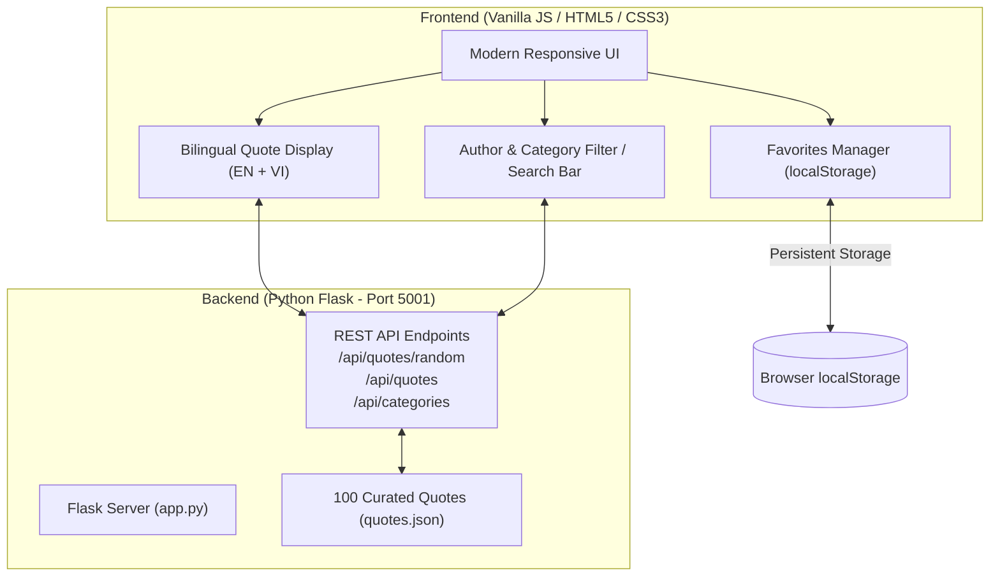

# Implementation Plan: Bilingual Famous Quotes Web Application

Build a responsive bilingual quote generator and search web application in `famous-quotes` using Vanilla HTML/CSS/JavaScript and a Python Flask API running on port 5001.

## Proposed System Architecture



## User Review Required

> [!IMPORTANT]
> - **Port 5001**: The application is configured to bind to `http://127.0.0.1:5001` or `http://localhost:5001`.
> - **Execution on Windows**: PowerShell execution policies may prevent running `Activate.ps1`. The Vietnamese `README.md` will clearly instruct users on how to use `Set-ExecutionPolicy -Scope Process -ExecutionPolicy Bypass` or `cmd` activation.
> - **Dataset**: 100 verified well-known quotes across major categories (Wisdom, Courage, Success, Inspiration, Life, Science, Art, Philosophy) with curated Vietnamese translations.

---

## Proposed Changes

### Project Structure (`famous-quotes/`)

```text
famous-quotes/
├── .gitignore
├── requirements.txt
├── app.py
├── quotes.json
├── README.md
├── static/
│   ├── css/
│   │   └── style.css
│   └── js/
│       └── app.js
├── templates/
│   └── index.html
└── tests/
    ├── __init__.py
    └── test_app.py
```

---

### Component 1: Data Store & Backend API (`Flask`)

#### [NEW] `famous-quotes/quotes.json`
- 100 bilingual quotes structured as:
  ```json
  [
    {
      "id": 1,
      "quote_en": "The only way to do great work is to love what you do.",
      "quote_vi": "Cách duy nhất để làm nên sự nghiệp vĩ đại là yêu những gì bạn làm.",
      "author": "Steve Jobs",
      "category": "Inspiration"
    },
    ...
  ]
  ```
- Categories: `Inspiration`, `Wisdom`, `Life`, `Success`, `Courage`, `Knowledge`, `Leadership`, `Friendship`, `Perseverance`, `Philosophy`.

#### [NEW] `famous-quotes/app.py`
- Flask application providing:
  - `GET /`: Renders `index.html`.
  - `GET /api/quotes/random`: Returns a random quote (optionally filtered by `?category=...`).
  - `GET /api/quotes`: Returns quotes list with optional filters (`?search=...`, `?author=...`, `?category=...`).
  - `GET /api/quotes/<id>`: Returns a single quote by numeric ID.
  - `GET /api/categories`: Returns unique list of categories with quote counts.
  - `GET /api/authors`: Returns unique list of authors.
- Configured to run on `port=5001`, `debug=True`.

#### [NEW] `famous-quotes/requirements.txt`
```text
Flask>=3.0.0
pytest>=8.0.0
```

#### [NEW] `famous-quotes/.gitignore`
```text
.venv/
env/
venv/
__pycache__/
*.pyc
*.pyo
*.pyd
.pytest_cache/
.DS_Store
```

---

### Component 2: Frontend (HTML, CSS, Vanilla JS)

#### [NEW] `famous-quotes/templates/index.html`
- Clean semantic HTML layout:
  - Header with app title, tagline, and theme/favorites counters.
  - Interactive toolbar:
    - Search input (real-time filter for quote text or author).
    - Category filter dropdown.
    - "Random Quote" button.
    - "Favorites" button with active badge count.
  - Main Hero Quote Card:
    - English quote text with quote mark styling.
    - Vietnamese translation below with distinct typography/color.
    - Author and category pill tag.
    - Action buttons: "Next Random Quote", "Copy Quote", "Toggle Favorite (❤️)".
  - Search / Filter Results grid:
    - Displays matching quotes when searching or filtering.
  - Favorites Modal / Drawer:
    - Shows all saved favorite quotes from `localStorage`.
    - Ability to remove items or export/clear favorites.

#### [NEW] `famous-quotes/static/css/style.css`
- Modern, clean aesthetic:
  - CSS variables for colors, typography, border-radius, and shadows.
  - Responsive design (mobile, tablet, desktop).
  - Smooth transitions for favorite toggling and quote transitions.

#### [NEW] `famous-quotes/static/js/app.js`
- Pure Vanilla JavaScript (no jQuery, no framework):
  - State management for current quote, search results, category filter, and favorites.
  - `localStorage` manager:
    - `getFavorites()`: reads `famous_quotes_favorites` array of IDs or objects.
    - `toggleFavorite(quote)`: adds or removes quote ID.
    - `isFavorite(quoteId)`: boolean check.
  - API communication using standard `fetch()` API.
  - Debounced search input for smooth author/keyword filtering.
  - Toast notification when copying quote to clipboard.

---

### Component 3: Testing & Documentation

#### [NEW] `famous-quotes/tests/test_app.py`
- Test suite verifying:
  - `quotes.json` loading and validation: exactly 100 quotes, each with `id`, `quote_en`, `quote_vi`, `author`, `category`.
  - Endpoint `GET /` returns 200 and HTML.
  - Endpoint `GET /api/quotes/random` returns a valid quote structure.
  - Endpoint `GET /api/quotes` returns filtered results by author and category.
  - Endpoint `GET /api/categories` returns unique non-empty category names.
  - Endpoint `GET /api/quotes/<id>` handles existing and non-existing IDs (404).

#### [NEW] `famous-quotes/README.md` (in Vietnamese)
- Detailed documentation:
  - Giới thiệu dự án và các tính năng chính.
  - Cấu trúc thư mục.
  - Hướng dẫn cài đặt và chạy trên Windows:
    - Cách tạo môi trường ảo `.venv` (`python -m venv .venv`).
    - Cách kích hoạt `.venv` trên Windows PowerShell (`.\.venv\Scripts\Activate.ps1`) và Command Prompt (`.\.venv\Scripts\activate.bat`), kèm cách xử lý lỗi ExecutionPolicy.
    - Cài đặt thư viện (`pip install -r requirements.txt`).
    - Chạy ứng dụng (`python app.py`) trên cổng 5001 (`http://127.0.0.1:5001`).
    - Hướng dẫn chạy automated tests (`pytest`).
    - Hướng dẫn sử dụng tính năng Favorites và lưu trữ `localStorage`.

---

## Verification Plan

### Automated Tests
1. Set up `.venv` inside `famous-quotes` using Python 3.14/3.13.
2. Install `requirements.txt`.
3. Run test suite:
   ```powershell
   cd famous-quotes
   .\.venv\Scripts\pytest -v
   ```
4. Confirm 100% test pass for quote schema, API responses, and filter behavior.

### Manual Verification
1. Launch Flask application:
   ```powershell
   .\.venv\Scripts\python app.py
   ```
2. Verify in browser at `http://127.0.0.1:5001`:
   - Random quote loads on page load with both English and Vietnamese translations.
   - Clicking "Random Quote" updates the card.
   - Searching by author name (e.g., "Albert Einstein", "Steve Jobs") filters correctly.
   - Filtering by category (e.g., "Wisdom", "Courage") updates the list.
   - Clicking favorite ❤️ button updates badge counter and persists in `localStorage` across page reloads.
   - Opening Favorites view shows the saved quotes and permits removing them.
