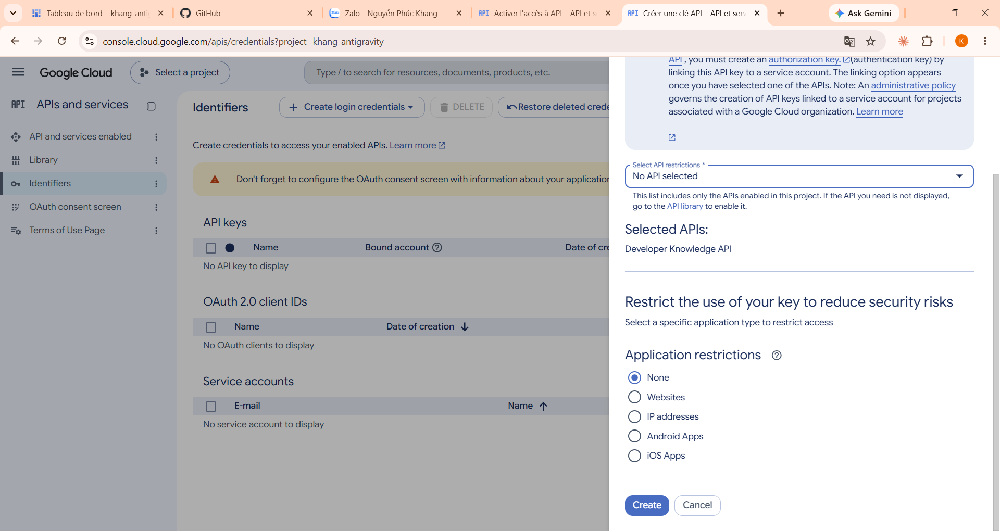
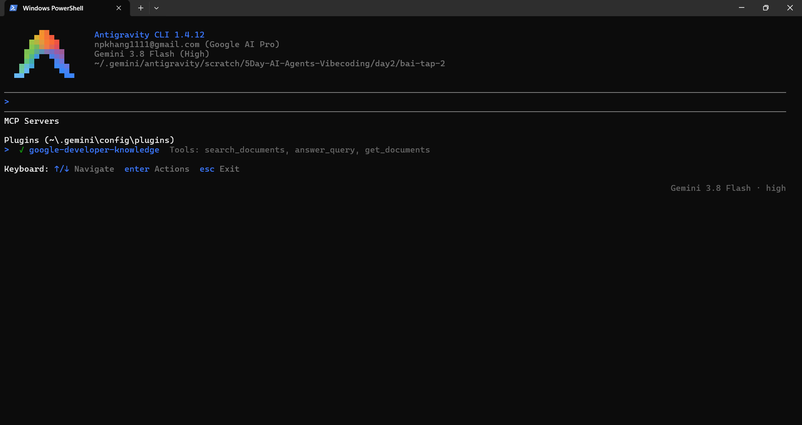

# Bài Tập 2: Khám Phá Google Developer Knowledge MCP Server Trong Google Antigravity 🧠🔌

Báo cáo và tài liệu thực hành chi tiết cho Bài tập 2 thuộc **Day 2: Agent Tools & Interoperability** trong khóa học **5-Day AI Agents: Intensive Vibe Coding Course With Google** trên Kaggle.

---

## 📌 Giới thiệu về MCP (Model Context Protocol)

**Model Context Protocol (MCP)** là một giao thức chuẩn mở được thiết kế nhằm chuẩn hóa cách thức các mô hình ngôn ngữ lớn (LLM) và các AI Agent kết nối an toàn với các nguồn dữ liệu, công cụ và tài nguyên bên ngoài:
- **Nguyên lý hoạt động**: Tách bạch kiến trúc giữa ứng dụng AI (**Client** như Google Antigravity, Claude Desktop,...) và hệ thống cung cấp dữ liệu/hành động (**MCP Servers**).
- **Lợi ích**: Giúp Agent có thể tương tác với cơ sở dữ liệu, API nội bộ, hệ thống tệp hoặc tài liệu lập trình chính thức mà không cần lập trình viên phải viết mã tích hợp riêng lẻ cho từng dịch vụ.
- **Tính năng vượt trội**: Cho phép AI truy vấn tài liệu kỹ thuật cập nhật theo thời gian thực thay vì chỉ dựa vào tri thức đóng băng (parametric memory) khi huấn luyện.

---

## 🚀 Các Bước Đã Thực Hiện (Setup & Configuration)

### Bước 1: Kích hoạt Developer Knowledge API trên Google Cloud
1. Truy cập [Google Cloud Console](https://console.cloud.google.com/) và chọn project làm việc (ví dụ: `khang-antigravity`).
2. Điều hướng tới **APIs & Services** > **Library**.
3. Tìm kiếm và kích hoạt **Developer Knowledge API** (`developerknowledge.googleapis.com`).

---

### Bước 2: Tạo Restricted API Key bảo mật
1. Truy cập **APIs & Services** > **Credentials** > Nhấp **Create Credentials** > chọn **API key**.
2. Để đảm bảo an toàn tuyệt đối theo nguyên tắc đặc quyền tối thiểu (Least Privilege), tiến hành giới hạn quyền (**API restrictions**):
   - Chọn **Restrict key**.
   - Chỉ tích chọn duy nhất: **Developer Knowledge API**.
3. Nhấp **Save**.


*Hình 1: Minh chứng cấu hình Restricted API Key cho Developer Knowledge API trên Google Cloud Console (`mcp-proof.png`)*

---

### Bước 3: Thêm cấu hình MCP Server vào Antigravity CLI
Mở hoặc tạo tệp cấu hình MCP tại đường dẫn người dùng `~/.gemini/config/mcp_config.json`:

```json
{
  "mcpServers": {
    "google-developer-knowledge": {
      "headers": {
        "X-Goog-Api-Key": "YOUR_API_KEY_HERE"
      },
      "serverUrl": "https://developerknowledge.googleapis.com/mcp"
    }
  }
}
```

> [!CAUTION]
> **Bảo mật API Key**: Tuyệt đối **không** commit API key thật lên kho lưu trữ GitHub công khai. Luôn giữ khóa trong tệp cấu hình người dùng cục bộ (`mcp_config.json`) và kiểm tra kỹ trước khi chia sẻ mã nguồn.

---

### Bước 4: Xác thực kết nối bằng lệnh `/mcp`
Khởi động Google Antigravity CLI và nhập lệnh slash command `/mcp` để kiểm tra danh sách MCP servers đang hoạt động:


*Hình 2: Lệnh `/mcp` hiển thị server `google-developer-knowledge` cùng 3 công cụ chính thức (`mcp-list.png`)*

---

## 🛠️ Bộ Ba Công Cụ Của Google Developer Knowledge MCP

Server `google-developer-knowledge` cung cấp 3 công cụ tiêu chuẩn giúp Agent tiếp cận hệ sinh thái tài liệu khổng lồ của Google:

| Tên công cụ (Tool Name) | Chức năng chính | Khi nào nên sử dụng? |
| :--- | :--- | :--- |
| **`search_documents`** | Tìm kiếm trong kho tài liệu chính thức của Google (Android, Firebase, Flutter, Google Cloud, Workspace, TensorFlow, Web,...). Trả về các đoạn trích (chunks), tên tài liệu và URI. | Khi cần tìm kiếm từ khóa chính xác, mã lệnh CLI, cờ tùy chọn (flags) hoặc các đoạn code mẫu cụ thể. |
| **`answer_query`** | Tổng hợp câu trả lời khái niệm bậc cao (high-level conceptual answer) được bảo chứng (grounded) từ kho tài liệu và luôn trích dẫn nguồn (`references`). | Khi đặt các câu hỏi khái niệm, kiến trúc, so sánh tính năng hoặc tìm hiểu khả năng hỗ trợ sản phẩm. |
| **`get_documents`** | Tải toàn bộ nội dung chi tiết của một tài liệu bằng định danh tài nguyên (`parent`/resource name). | Khi các đoạn trích từ `search_documents` chưa cung cấp đủ ngữ cảnh và cần đọc trọn vẹn tài liệu hướng dẫn. |

---

## 🧪 3 Câu Lệnh Kiểm Thử Thực Tế (Test Prompts)

### 🔹 Test Prompt 1: Kiểm thử `answer_query` (Google Workspace MCP Support)
* **Prompt:**
  ```text
  Based on the Google Developer Knowledge, does Google Workspace support MCP servers?
  ```
* **Mục tiêu:** Xác minh khả năng Agent tự động nhận biết câu hỏi về tài liệu Google, kích hoạt MCP tool `answer_query` và trích xuất thông tin chuẩn xác có dẫn chứng.
* **Kết quả:** Agent đã gọi công cụ `answer_query` và phản hồi chuẩn xác:
  - Google Workspace hiện đã hỗ trợ Remote MCP Servers (Developer Preview).
  - Cung cấp các endpoint chuyên biệt cho Gmail, Google Drive, Docs, Sheets, Slides, Calendar, Chat, People API, Classroom.
  - Sử dụng giao thức Streamable HTTP với xác thực OAuth 2.0.
  - Trích dẫn chính xác tài liệu nguồn: `developers.google.com/workspace/guides/configure-mcp-servers`.

---

### 🔹 Test Prompt 2: Kiểm thử `search_documents` (Tra cứu chuẩn API Google Drive)
* **Prompt:**
  ```text
  How to upload a file to Google Drive using Google Drive API v3 in Python with OAuth 2.0?
  ```
* **Mục tiêu:** Kiểm tra khả năng tra cứu tài liệu SDK và thư viện chính thức của Google (`google-api-python-client`, `MediaFileUpload`, `InstalledAppFlow`).
* **Kết quả:** Agent truy xuất chính xác tài liệu Google Drive API v3, xác định đúng phạm vi quyền an toàn (`https://www.googleapis.com/auth/drive.file`), cấu trúc upload tệp phân đoạn (`resumable=True`), và cơ chế cấp quyền OAuth 2.0 cục bộ.

---

### 🔹 Test Prompt 3: Sinh mã nguồn thực thi từ tri thức MCP (`upload_to_drive.py`)
* **Prompt:**
  ```text
  Generate a complete, robust Python script upload_to_drive.py using Google Drive API v3 and OAuth 2.0 based on the official Developer Knowledge.
  ```
* **Mục tiêu:** Tận dụng tri thức chuẩn vừa tra cứu để sinh ra mã nguồn sạch, xử lý đầy đủ các trường hợp xác thực, tái sử dụng token và tải file lên Google Drive.
* **Kết quả:** Tạo ra tệp kịch bản hoàn chỉnh [`upload_to_drive.py`](./upload_to_drive.py).

---

## 📄 Kịch Bản Sinh Ra Từ MCP: `upload_to_drive.py`

Tệp [`upload_to_drive.py`](./upload_to_drive.py) được xây dựng hoàn toàn từ các tài liệu tham khảo chính thức thu thập qua MCP server:
- **Xác thực an toàn**: Sử dụng OAuth 2.0 Client ID, tự động mở trình duyệt cấp quyền trong lần chạy đầu tiên và lưu token phiên làm việc vào `token.json` để tự động làm mới (auto-refresh) các lần sau.
- **Phạm vi quyền tối thiểu**: Sử dụng scope `'https://www.googleapis.com/auth/drive.file'` — chỉ có quyền truy cập vào các tệp do ứng dụng tự tạo, không xâm phạm các tệp riêng tư khác trên Google Drive của người dùng.
- **Tải lên tin cậy**: Sử dụng `MediaFileUpload` với cơ chế upload lũy tiến (`resumable=True`), giúp xử lý ổn định cả các tệp có dung lượng lớn.

```powershell
# Cách chạy upload_to_drive.py
python upload_to_drive.py <duong_dan_file> [folder_id_tuy_chon]
```

---

## 🔒 Quản Lý Bảo Mật & `.gitignore`

Để đảm bảo an toàn thông tin khi làm việc với Google APIs và Cloud Credentials, dự án đã cấu hình tệp `.gitignore` chặn hoàn toàn các tệp nhạy cảm:
- `credentials.json`: Thông tin bí mật của OAuth 2.0 Client ID tải từ Google Cloud.
- `token.json`: Token xác thực người dùng sau khi hoàn tất luồng OAuth.
- `.env*`: Tất cả các tệp cấu hình chứa biến môi trường và khóa bí mật.

---

## 📂 Cấu Trúc Thư Mục Bài Tập 2

```text
day2/bai-tap-2/
├── .gitignore              # Loại trừ credentials.json, token.json, .env
├── README.md               # Tài liệu báo cáo chi tiết bài tập 2 (tệp này)
├── mcp-list.png            # Ảnh chụp minh chứng lệnh /mcp hiển thị server & tools
├── mcp-proof.png           # Ảnh chụp minh chứng tạo Restricted API Key trên Google Cloud
└── upload_to_drive.py      # Mã nguồn Python upload Google Drive tạo từ tri thức MCP
```

---
[⬅️ Quay lại Day 2](../README.md) | [🏠 Quay lại trang chủ](../../README.md)
